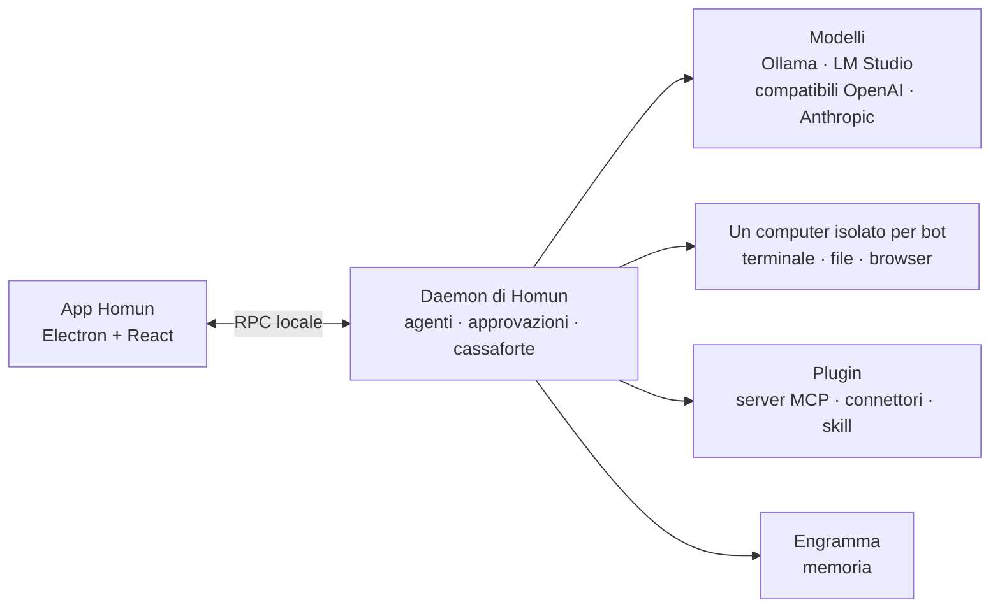

<div align="center">


# Homun

**Una squadra di agenti AI che vive sul tuo Mac.**<br/>
Ogni bot ha il suo computer isolato, usa il modello che scegli tu — locale o cloud —<br/>
e niente di importante succede senza il tuo OK.

[](https://github.com/homun-app/homun-releases/releases)
[](https://github.com/homun-app/homun-releases/releases)
[](LICENSE)

[**Scarica**](https://github.com/homun-app/homun-releases/releases) · [Cosa fa](#cosa-puoi-fare) · [Come funziona](#come-funziona) · [Roadmap](#roadmap) · [English](README.md)

</div>

## Perché Homun

Quasi tutti gli assistenti AI sono una chat sola, con un modello solo, sul server di qualcun altro. Homun è diverso:

- **I tuoi modelli, i tuoi dati, la tua spesa.** Tutto in locale con Ollama o LM Studio, oppure qualsiasi API compatibile OpenAI o Anthropic. Li mescoli per bot: un modello piccolo e locale per il lavoro privato o semplice, uno grande nel cloud solo dove conviene.
- **Una squadra, non un chatbot.** Crei bot con il loro ruolo, li metti in un team con un coordinatore e li guardi dividersi il lavoro, chiedersi aiuto e consegnarti documenti finiti.
- **Un computer vero per ogni bot.** Ogni bot lavora nella sua macchina Linux isolata — file, terminale, browser — separata dal tuo Mac, con l'accesso alla rete sotto controllo.
- **Decidi tu.** Ogni azione che conta chiede prima. La consenti una volta, sempre, per un sito o per una missione; pagamenti e messaggi inviati a nome tuo chiedono sempre. Ogni decisione finisce in un registro che puoi rivedere e revocare.

## Cosa puoi fare

**Bot e team**
- Ogni bot ha un nome, un ruolo e un modello.
- Raggruppi i bot in un **team**: il coordinatore pianifica, i membri eseguono e la chat di squadra racconta il lavoro.
- I bot si passano il lavoro in modo onesto: se uno è occupato, il messaggio va in coda con l'orario di partenza, e puoi annullarlo.
- **Routine**: lavori ricorrenti a orario, e suggerimenti da ciò che chiedi spesso.

**Plugin**
- Una pagina **Plugin** per tutto ciò che dà capacità ai bot: connettori di app, server MCP e skill.
- Colleghi le app direttamente via MCP o dal catalogo di Composio; importi i server MCP e le skill che usi già in altre app.
- Autorizzazioni per gruppo (lettura / scrittura / altro), accesso per bot e uno stato che dice *perché* qualcosa non va.

**Il computer del bot**
- Una macchina isolata per bot (`container` di Apple su macOS), con una `/workspace` condivisa.
- Un browser vero che il bot usa, con lo schermo dal vivo in una finestra a parte.
- Se vuoi, il controllo delle app del tuo Mac (schermate, clic, digitazione), ogni azione approvata da te.

**Sicurezza di progetto**
- Le approvazioni in un posto solo, ovunque tu sia: sopra il campo di scrittura, in «Da approvare», sul badge del Dock e nelle notifiche.
- **Contenuti non fidati**: dopo che un bot ha letto una pagina web o una email, le sue azioni di scrittura tornano a chiedere, anche quelle che avevi consentito. Una prima difesa contro la prompt injection.
- Una **Cassaforte** cifrata (AES-256-GCM, chiave nel Portachiavi di macOS) per login, segreti e contatti: i bot vedono i nomi, mai i valori, e i segreti vengono tolti da ogni output.

**Il tuo lavoro, conservato**
- Una **Libreria** con i documenti prodotti dai bot, con le anteprime.
- Memoria a lungo termine con **Engramma**, il nostro motore di memoria open source scritto in Rust.
- Uso e costi per modello, per sapere sempre quanto spendi.

## Come funziona



- Il **daemon** fa lavorare i bot in background, anche a finestra chiusa.
- Ogni chiamata a uno strumento passa dal **controllo dei permessi**: i comandi del terminale sono analizzati con tree-sitter, quindi consentire `git status` non consente mai `git push`.
- Le conversazioni sono salvate come **eventi** in un database SQLite locale. Dal tuo Mac escono solo le richieste ai fornitori di modelli e alle app che configuri tu.

## Installazione

1. Scarica l'ultimo `.dmg` dalle [Release](https://github.com/homun-app/homun-releases/releases) (macOS su Apple Silicon — per ora in **beta**).
2. Trascina Homun in Applicazioni e aprilo. L'app è firmata e notarizzata.
3. La guida iniziale ti aiuta a scegliere un modello, locale o cloud, e a creare il primo bot.

Homun si aggiorna da solo; il canale stabile o beta si sceglie nelle Impostazioni.

### Dal codice sorgente

Servono Node.js 24 e macOS su Apple Silicon.

```bash
git clone https://github.com/homun-app/homun-core.git
cd homun-core
npm install
npm run dev
```

I controlli: `npm run typecheck` e `npm test`.

## Roadmap

- **Windows e Linux** — lo stesso computer isolato (WSL2 su Windows, Podman su Linux).
- **Un modello locale adatto alla tua macchina**, incluso e scelto in base all'hardware.
- **Instradamento intelligente** tra modelli locali e cloud, con un tetto di spesa e il «perché è andato lì».
- **Homun per l'ufficio** — un Homun su ogni computer, che condividono memoria e compiti da pari a pari, senza un server centrale con i tuoi dati.
- **Engramma come prodotto a sé**, usabile dalle altre app AI via MCP.

## Contribuire

Issue e pull request sono benvenute. Per modifiche grandi apri prima una issue, così concordiamo la direzione, e prima di inviare esegui `npm run typecheck` e `npm test`.

Hai trovato un problema di sicurezza? Non aprire una issue pubblica: usa la [segnalazione privata delle vulnerabilità](https://github.com/homun-app/homun-core/security/advisories/new).

## Licenza

[Apache-2.0](LICENSE) — © The Homun authors.
