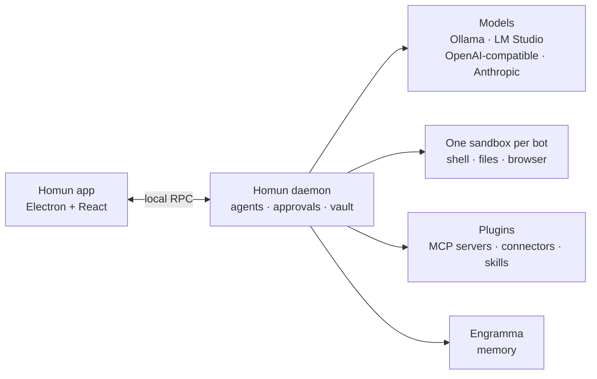

<div align="center">


# Homun

**A team of AI agents that lives on your Mac.**<br/>
Each bot gets its own isolated computer, runs on the model you choose — local or cloud —<br/>
and nothing important happens without your OK.

[](https://github.com/homun-app/homun-releases/releases)
[](https://github.com/homun-app/homun-releases/releases)
[](LICENSE)
[](https://github.com/homun-app/homun-core)

[**Download**](https://github.com/homun-app/homun-releases/releases) · [Features](#what-you-can-do) · [How it works](#how-it-works) · [Roadmap](#roadmap) · [Italiano](README.it.md)

</div>

<!-- hero: docs/readme/hero.png — a team at work (coming soon) -->

## Why Homun

Most AI assistants are one chat with one model on someone else's server. Homun is different:

- **Your models, your data, your bill.** Run fully local with Ollama or LM Studio, or plug in any OpenAI-compatible API or Anthropic. Mix them per bot: a small local model for private or simple work, a big cloud model only where it pays off.
- **A team, not a chatbot.** Create bots with their own role, put them in a team with a coordinator, and watch them split the work, ask each other for help and hand you finished documents.
- **A real computer for every bot.** Each bot works inside its own sandboxed Linux machine — files, shell, browser — isolated from your Mac, with controlled network access.
- **You stay in charge.** Every action that matters asks first. Allow it once, always, for a site or for one mission; payments and messages sent on your behalf always ask. Every decision lands in a log you can review and revoke.

## What you can do

**Bots and teams**
- Give each bot a name, a role and a model.
- Group bots into a **team**: a coordinator plans, members execute, and the team chat tells the story of the work.
- Bots delegate to each other honestly: when one is busy, the message is queued with a visible start time you can cancel.
- **Routines**: recurring jobs on a schedule, plus suggestions based on what you keep asking for.

**Plugins**
- One **Plugins** page for everything that gives bots new abilities: app connectors, MCP servers and skills.
- Connect apps directly over MCP or through Composio's catalog; import the MCP servers and skills you already use in other apps.
- Per-plugin permissions by group (read / write / other), per-bot access, and a live status that tells you *why* something is off.

**The bot's computer**
- A sandboxed machine per bot (Apple's `container` on macOS), with a shared `/workspace`.
- A real browser the bot can drive, with a live view of its screen in a separate window.
- Optional control of the apps on your Mac (screenshots, clicks, typing), each action approved by you.

**Safety by design**
- Approvals in one place, wherever you are: right above the message box, in "To approve", on the Dock badge and in notifications.
- **Taint tracking**: after a bot reads untrusted content (a web page, an email), its write actions ask again — even the ones you had allowed. A first line of defense against prompt injection.
- An encrypted **vault** (AES-256-GCM, key in the macOS Keychain) for logins, secrets and contacts: bots see names, never values, and secrets are redacted from every output.

**Your work, kept**
- A **Library** of the documents your bots produce, with previews.
- Long-term memory powered by **Engramma**, our open-source memory engine written in Rust.
- Usage and cost per model, so you always know what you are spending.

## How it works



- The **daemon** keeps your bots working in the background, even with the window closed.
- Every tool call goes through the **permission gate**: shell commands are parsed with tree-sitter, so allowing `git status` never silently allows `git push`.
- Conversations are **event-sourced** in a local SQLite database. Nothing leaves your Mac except the requests to the model providers and apps you configure.

## Install

1. Download the latest `.dmg` from [Releases](https://github.com/homun-app/homun-releases/releases) (macOS on Apple Silicon — currently in **beta**).
2. Drag Homun to Applications and open it. The app is signed and notarized.
3. The setup guide helps you pick a model, local or cloud, and create your first bot.

Homun updates itself; choose the stable or the beta channel in Settings.

### Build from source

Requires Node.js 24 and macOS on Apple Silicon.

```bash
git clone https://github.com/homun-app/homun-core.git
cd homun-core
npm install
npm run dev
```

Run the checks with `npm run typecheck` and `npm test`.

## Roadmap

- **Windows and Linux** — the same sandbox design (WSL2 on Windows, Podman on Linux).
- **A local model that fits your machine**, bundled and chosen for your hardware.
- **Smart routing** between local and cloud models, with a spending cap and a clear "why it went there".
- **Homun for the office** — a Homun on every computer, sharing memory and tasks peer-to-peer, with no central server holding your data.
- **Engramma as a standalone product**, usable from other AI apps over MCP.

## Contributing

Issues and pull requests are welcome. For larger changes, please open an issue first so we can agree on the direction, and run `npm run typecheck` and `npm test` before submitting.

Found a security issue? Please don't open a public issue — use [private vulnerability reporting](https://github.com/homun-app/homun-core/security/advisories/new).

## License

[Apache-2.0](LICENSE) — © The Homun authors.
